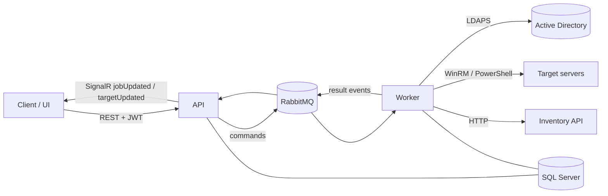

# Enterprise AD Password Manager

> Rotate an Active Directory service-account password **and** every place that account is used — Windows services, IIS, scheduled tasks, COM+ — as one tracked, audited job.


## Why

Changing a service account's password in AD is the easy part. The outage comes afterwards, from the Windows service, IIS app pool or scheduled task on some server that still holds the old password. This project turns that rotation into a single job that:

1. **Discovers** where the account is used on each target server,
2. **Changes** the password in AD over LDAPS,
3. **Updates** every discovered resource idempotently,
4. **Verifies** the result and reports progress live,

with an audit trail and server-side authorization at every step.

## Architecture



**Onion architecture** with an event-driven worker:

| Layer | Responsibility |
|---|---|
| `Domain` | Entities and enums — no secrets, no infrastructure |
| `Application` | Use cases, abstractions, messaging contracts, RBAC roles |
| `Infrastructure` | EF Core, MassTransit/RabbitMQ, LDAPS, WinRM executor, discovery/update/verify strategies, AES-GCM payload protection, audit |
| `API` | OIDC + RBAC, controllers, SignalR hub, audit reporting, security headers, correlation IDs |
| `Worker` | Command consumers, inventory sync job, result event publishers |
| `tests` | Infrastructure unit tests |

### Supported resources

| Resource | Discovery | Update |
|---|:-:|:-:|
| Windows service | ✅ | ✅ |
| IIS app pool / site / web app / virtual directory | ✅ | ✅ |
| Scheduled task | ✅ | ✅ |
| COM+ application | ✅ | ✅ |
| User rights (secedit export) | ✅ | — |

New resource types plug in through `IDiscoveryStrategy` / `IUpdateStrategy`.

## Security model

- **Passwords never travel in plain text:** command payloads are encrypted with **AES-GCM** (with a key ID for rotation) and decrypted only inside the worker, in memory.
- **Log redaction:** `password`, `token`, `secret`, `apikey` and `authorization` patterns are scrubbed before anything is written.
- **AuthN/AuthZ:** OIDC with a group allowlist, a database user allowlist and roles (`Viewer`, `Operator`, `Admin`, `SuperAdmin`); job and hub access are checked per job on the server.
- **Audit:** jobs, admin actions and role changes are recorded and reportable by admins.
- **Resilience:** retries, a circuit breaker, a kill switch, a transactional outbox, quorum queues and a stuck-target watchdog.
- **Config:** `appsettings*.json` contain **placeholders only** (`<SQL_SERVER_CONNECTION_STRING>`, `<LDAP_HOST>`, …). Real values come from a secret store or environment variables.

## Tech stack

.NET 8 · ASP.NET Core · EF Core · SQL Server 2022 · RabbitMQ + MassTransit · SignalR · Serilog · System.DirectoryServices.Protocols (LDAPS) · PowerShell / WinRM

## Getting started

```bash
git clone https://github.com/aknonr/LDAP_Project.git
cd LDAP_Project
dotnet build LDAP_Project.sln
dotnet test tests/Infrastructure.Tests
```

To run the API and the worker you need SQL Server, RabbitMQ, an LDAPS-reachable domain controller and an OIDC provider. Supply these through environment variables or user secrets, never in the committed files:

- `ConnectionStrings:Default`
- `Messaging:RabbitMq:*`
- `Ldap:*`
- `Auth:Oidc:*`
- `Security:PayloadEncryption:*`
- `InventoryApi:*` (optional inventory source)

EF Core migrations: see [`Infrastructure/Migrations/Migration_README.md`](Infrastructure/Migrations/Migration_README.md).

## Documentation

Detailed design notes are in [`Document/`](Document) (in Turkish):

- [Project overview](Document/Project_General_Readme.txt)
- [Config and secrets](Document/Config_and_Secrets_Readme.txt) · [Log redaction](Document/Logging_Redaction_Readme.txt) · [Security checklist](Document/Security_Checklist_Readme.txt)
- [Messaging topology](Document/Messaging_Topology_Readme.txt) · [Reliability](Document/Reliability_and_Error_Handling_Readme.txt) · [Realtime updates](Document/Realtime_Updates_Readme.txt)
- [LDAPS change](Document/Ad_Ldaps_Change_Readme.txt) · [Discovery](Document/Discovery_Engine_Readme.txt) · [Update](Document/Update_Engine_Readme.txt) · [Verify](Document/Verify_Flow_Readme.txt)
- [Users and roles](Document/User_Role_Management_Readme.txt) · [Inventory API sync](Document/Inventory_Api_Readme.txt) · [API contract](Document/API_Contract_Readme.txt)

## Roadmap

- [x] Config/secrets skeleton, EF Core model, OIDC + RBAC
- [x] Inventory sync, LDAPS password change
- [x] Discovery and update engines, verify flow
- [x] MassTransit topology, SignalR live updates, audit trail
- [x] Resilience hardening, authorization hardening
- [ ] Admin user/role management (partial)
- [ ] Web UI
- [ ] Key and certificate rotation runbooks, secret-store integration

## Disclaimer

This is a personal portfolio project. It contains no real environment data: hostnames, credentials and organization details are placeholders. Test it in an isolated lab before pointing it at a real directory.
